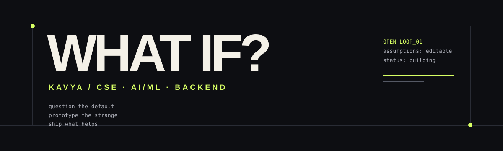

 

`COMPUTER SCIENCE & ENGINEERING · HONOURS · INDIA`

### **Hello, curious human.**

I build practical AI and backend systems — then spend an unreasonable amount of time asking whether the original problem was framed correctly.

[GitHub](https://github.com/Kavya-216) · [Mitra](https://github.com/Kavya-216/Mitra-Legal_and_Mental_aid_for_Women) · [Udaan](https://github.com/Kavya-216/Udaan-Disability_Bridge)

---

## The short version

I like the part of software that sits between an idea and its proof:

**a useful question** → **a stubborn prototype** → **a system someone can actually use**

My work lives across **AI/ML, retrieval-augmented generation, backend architecture, databases, computer vision, and accessibility**. I also help organise student technology events, which is a polite way of saying I enjoy turning chaos into a schedule.

## Workbench

<table>
<tr>
<td width="62%" valign="top">

### MITRA
#### Legal & Mental Aid Platform for Women

The project currently closest to the centre of the map: an AI-assisted platform for making legal resources and mental-health support easier to access.

I worked on the **backend and database layer**, including the foundation around resources, support flows, and retrieval.

`Python` `Supabase` `RAG` `Node.js` `React / TypeScript`

**Runner-up · SheBuilds Hackathon**

<a href="https://github.com/Kavya-216/Mitra-Legal_and_Mental_aid_for_Women">read the repository →</a>

</td>
<td width="38%" valign="top">

### The brief

Build help that feels less like a maze.

### The constraint

Useful AI has to survive contact with real people, real data, and real edge cases.

### The note

The database is not “just storage.” It is where the product remembers what matters.

</td>
</tr>
</table>

 

<table>
<tr>
<td width="50%" valign="top">

### UDAAN
#### Bridging the Accessibility Gap

An integrated accessibility ecosystem spanning employment, welfare, advocacy, voice interaction, computer vision, and verified support tools.

Its documented architecture includes React, Node.js, SQLite, Supabase, Solidity, MediaPipe, RAG/NLP, and multilingual speech recognition.

<a href="https://github.com/Kavya-216/Udaan-Disability_Bridge">inspect the build →</a>

</td>
<td width="50%" valign="top">

### More signals

Public repositories also include experiments in:

- causal reinforcement-learning recommendations
- generative AI
- blockchain-based file integrity
- autonomous rover simulation
- small systems built to understand how the pieces fit

Names and links are kept off the main stage until their documentation earns the spotlight.

</td>
</tr>
</table>

## Technical identity

<table>
<tr>
<td width="33%" valign="top">

**Build with**

Python · C · SQL · JavaScript · TypeScript

</td>
<td width="33%" valign="top">

**Think about**

ML · neural networks · RAG · computer vision · data mining

</td>
<td width="33%" valign="top">

**Make reliable**

APIs · databases · backend architecture · accessibility

</td>
</tr>
</table>

 

 

One quiet instrument panel. The work stays louder.

---

### FIELD NOTE / 02

> **If the answer is obvious, check the question.**

`status: building · assumptions: under review · next experiment: classified`

