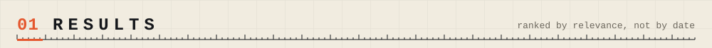
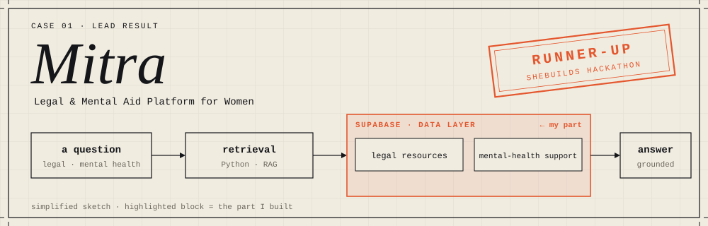
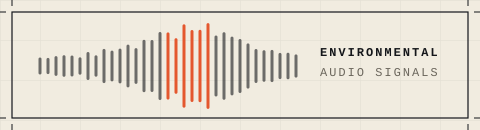
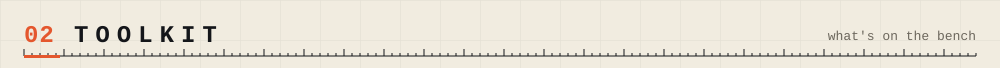

<p align="center">
  
</p>

I'm **Kavya**, a Computer Science & Engineering undergrad (Honours) who keeps getting pulled toward the part of a system everyone else skipped: the data layer, the edge case that was quietly waiting in production, the assumption nobody questioned.

I like AI/ML best when it turns into something a person can actually use, and backend work when it lets a demo survive contact with reality. Most of what's below started as a question.

<p align="center">
  
</p>

<p align="center">
  
</p>

<p align="center">
  
</p>

**What it is.** An AI-assisted platform that makes legal resources and mental-health support easier for women to reach.<br>
**What I built.** The backend and database layer behind the legal-resource and mental-health content.<br>
**Stack.** `Python` · `Supabase` · `RAG` · `Node.js` · `React / TypeScript` (the basics)<br>
**Result.** Runner-up, SheBuilds Hackathon.

<br>

<table>
<tr>
<td width="50%" valign="top">



**Udaan**<br>
Computer-vision work aimed at practical, real-world accessibility. An award-winning project.<br>
`Python` · `TensorFlow Lite` · `MediaPipe`

</td>
<td width="50%" valign="top">



**EcoSentry**<br>
An exploration of environmental audio intelligence and neural-network signal processing.<br>
`Python` · `Neural Networks` · `Audio Processing`

</td>
</tr>
</table>

<br>

<p align="center">
  
</p>

```text
languages  Python · C · SQL · JS · TS
ai / ml    ML · neural nets · RAG · CV
backend    Node.js · Supabase · APIs
interface  React, the basics
```

Off the bench: organising student tech events and building things with other people.

<p align="center">
  
</p>
